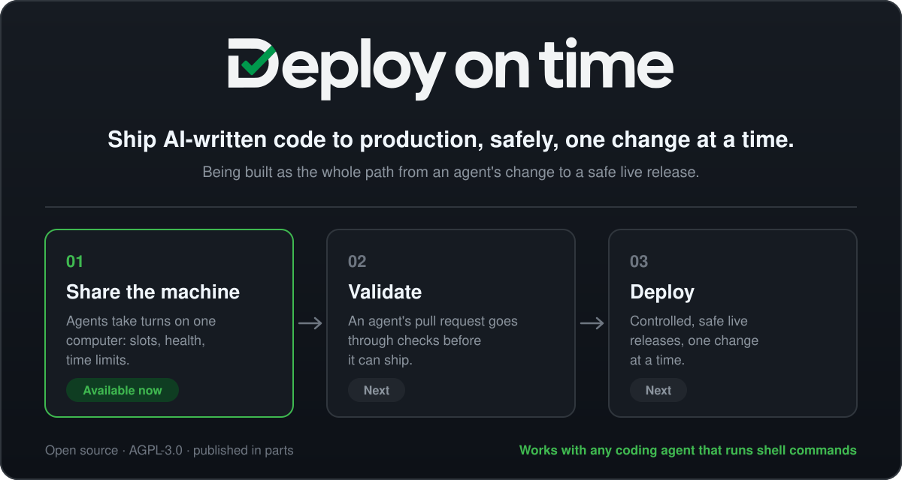

<p align="center">
  
</p>

<p align="center">
  <a href="https://github.com/Moezat220/deployontime/actions/workflows/test.yml"></a>
  <a href="LICENSE"></a>
  
  
  
  <a href="https://www.npmjs.com/package/deployontime"></a>
  <a href="https://glama.ai/mcp/servers/Moezat220/deployontime"></a>
</p>

<p align="center">
  <a href="#install">Install</a> ·
  <a href="#how-it-works">How it works</a> ·
  <a href="#faq">FAQ</a> ·
  <a href="queue/README.md">Manual</a> ·
  <a href="#roadmap">Roadmap</a>
</p>

<br>

**DeployOnTime is an open-source autonomous software factory in the making** for building with AI coding agents:
several agents working side by side today; tests, reviews and security checks, safe live releases and AI orchestration
next. It is published one part at a time, and the first part, the machine queue, works on its own.

**Ready to use today: the machine queue** (macOS and Linux). It lets several coding agents share one computer without
overloading it. The next parts are on the [roadmap](#roadmap).

<p align="center">
  
  <br>
  <sub>Example output, shortened.</sub>
</p>

## The problem

Coding agents each start their own test runs and builds. Three agents on one computer can mean three full test suites
at once: memory and CPU run out, tests that pass on their own start timing out, and an agent then "fixes" code that
was never broken. Each agent sees only its own run, so neither you nor the agents can see the real cause.

## What you get

| | Without a queue | With `dotime-queue` |
| --- | --- | --- |
| **Several agents start test suites** | They all run at once | At most 2 run together (`slots`); the rest wait their turn |
| **The computer is already busy** | New jobs pile on | Jobs wait while CPU, memory or disk is short, or the battery is low |
| **A job hangs** | It can run until someone notices | It is stopped at its time limit, with everything it started (exit 124) |
| **A check keeps failing on the same code** | An agent may keep re-running it | A third try is blocked for up to 6 hours (exit 3) until the code changes or `--after-fix` is given |
| **This commit already has a green run** | It may run again | A test or lint check that already passed on the same clean commit, in the same folder, is skipped (exit 0); `--no-skip` runs it anyway |
| **Where did the time go?** | No record | `dotime-queue history` totals waits and results per project |
| **Dev servers left running** | They keep using memory | An optional reaper stops the idle ones |

## How it works

The queue is a command that agents put in front of their heavy commands:

```
dotime-queue run --label "shop-api: unit tests" -- npm test
```

1. **Turn.** The job takes the next free slot, or waits its turn.
2. **Health.** Has the computer room for it? Before it starts, the queue looks at CPU load, free memory, free disk
   and, on battery, the charge.
3. **Limit.** It runs under a time limit learned from earlier passed runs: first the command's own, then those of its
   kind of job in the project, once either has five; before that, 30 minutes. A new command that takes longer than
   what its kind has learned (which can be as short as 10 minutes) needs `--max-run <minutes>`.
4. **Record.** Its wait, run time and result go into a journal that later runs and `history` use.

When a check fails that both passed and failed before on the same commit from a clean tree, `run` adds a `flaky:` line
saying the failure may not come from the change; it is advice only and changes no exit code. Timeouts, stops and runs
with uncommitted changes never count, and `dotime-queue flaky` lists the flaky checks.

Only commands started through the queue are queued. A command an agent runs directly, such as a plain `npm test`, is
not. The queue never edits your repository; it keeps its state in `~/.dotime`.

## Measured

On a Mac, 4 agents start the same test suite at the same moment. Each suite runs 5 threads (100 timed tests) and holds 2
GB, and the Mac has half as many cores as the 4 suites have busy threads, so started together they ask for twice the CPU
there is; through the queue at most 2 suites run together (its default of 2 slots). A test fails when it takes more than
1.6 times as long as when one suite runs by itself, so this setup shows what doubling the load does; a looser timeout or
a lighter load would narrow the gap. After a failure an agent waits 5 to 30 s (the same random waits both ways) and runs
the suite again, up to 8 runs in all. Three runs each way:

| | Started directly | Through `dotime-queue` |
| --- | --- | --- |
| **Tests that failed on the first try** | 400 of 400, in every run | 0 of 400, in every run |
| **Time until every agent had a green run** | 373 s in one run; in the other two, some agents were still red after 8 runs (447 s and 469 s) | 57 to 58 s |
| **Suite runs** | 25 to 32 | 4 |

The code under test never changes, so every failure comes from the busy computer. The suite is a stand-in, not a real
project, and your numbers will differ with your machine and your tests. To run it yourself (it keeps every core busy
for about half an hour; it uses a temporary state folder and repository):

```
node bench/run.mjs
```

Anyone can also run it on GitHub's macOS runner: in Actions, pick "Benchmark (manual)" and press Run workflow. It is
not one of the required checks and only starts by hand. The runner is smaller than the Mac above, so the settings are
scaled to it by the same rule (about twice as many busy threads as cores; less memory per thread only if 400 MB would
not fit in half the RAM); the runner's cores and memory are recorded in the results. Every run uploads all its results
(the raw JSON, the full output and the queue journals) as one artifact named benchmark-results, whatever they show.

## Install

Requirements: macOS or Linux, Node 22 or newer, git 2.31 or newer. The package has no dependencies.

```
npm install -g deployontime    # puts dotime-queue and dotime-mcp on your path
dotime-queue status
```

To work from the source instead: `git clone https://github.com/Moezat220/deployontime.git`, then `npm link` in its
top folder.

A job waits while the computer is short of room: by default below 20% free memory or 10 GB free disk, and while the
CPU is overloaded. On a small machine, `dotime-queue status` shows whether that gate is shut, and the limits can be
lowered in `~/.dotime/config.json`, for example `{ "health": { "minFreeMemPct": 5, "minFreeDiskGB": 2 } }`.

Then tell your agents to use it. In the folder of each project they work in, run:

```
dotime-queue setup           # shows what it would add, and changes nothing
dotime-queue setup --write   # adds it
```

It works in the top folder of the git repository. It adds the queue instruction to the project's `AGENTS.md`,
`CLAUDE.md` and `.claude/CLAUDE.md`, between a begin and an end marker, or creates `AGENTS.md` when there is none; a
second run updates that block and leaves the rest of each file alone.
`--mcp` also prints the settings for the [MCP server](#use-with-an-mcp-client). The block says, in short:

```
Start every test run, build and other heavy command through the queue:
dotime-queue run --label "<project>: <task>" -- <command>
A test or lint run that prints "skipped:" already passed on this exact commit and exits 0; add --no-skip in front
of the -- only to run it again on purpose. Exit 75 means the job gave up waiting for a slot, 124 that it hit
its run limit, 3 that the same check already failed twice on unchanged code.
```

A coding agent that opens this repository finds what it needs in [AGENTS.md](AGENTS.md).

You do not need to tell agents to call `dotime-queue passed` first: `run` checks for a pass by itself, in the same
folder, with the same label, command and code. `--no-skip` on an outer job also reaches the checks it runs through the
queue.

The text before the colon in a label is the project name; limits and history are kept per project.

To remove it: `npm uninstall -g deployontime`, delete `~/.dotime`, and take the reaper out of your scheduler if you
added it.

Every command, flag, exit code and setting is in the [queue manual](queue/README.md).

## Use with an MCP client

`dotime-mcp` is an MCP server on standard input and output that offers the queue to agents as tools. It has no
dependencies either, and the install puts it on your path next to `dotime-queue`. Add one entry to your client's MCP
server settings:

```json
{
  "mcpServers": {
    "dotime-queue": { "command": "dotime-mcp" }
  }
}
```

Clients differ in where that file lives and in how its top level is named; see your client's documentation. Without
installing it first, `"command": "npx", "args": ["-y", "-p", "deployontime", "dotime-mcp"]` fetches the package and
starts the server. From a clone that was not linked, use
`"command": "node", "args": ["<path to the clone>/mcp/server.mjs"]`. To use another state folder, add
`"env": { "DOTIME_HOME": "<absolute path of the folder>" }`, as for the command. A relative path is taken from the
folder the server starts in, and its jobs are handed that absolute path.

| Tool | Arguments | What it gives |
| --- | --- | --- |
| `queue_status` | none | The lines of `dotime-queue status`, with the slot and line counts as fields |
| `queue_passed` | `match`, `cwd` | The stamp or no-stamp line of `dotime-queue passed`, with `stamp` as `true` or `false` |
| `queue_history` | `days` (1 to 365, default 7) | The lines of `dotime-queue history` |
| `queue_run` | `label`, `command` (a list of words), `cwd`, `kind`, `maxRunMin`, `noSkip`, `afterFix` | Starts `dotime-queue run` in the background and returns a job id at once |
| `queue_job` | `jobId`, `tailLines` (0 to 500, default 40) | `starting`, `waiting`, `running`, `finished` or `lost`; for a finished job its exit code and outcome (`ran`, `skipped`, `refused`, `timed-out`, `gave-up` and the others), `flaky` (null, or the counts and note for a failed or refused run of a flaky check), and the last lines of its output |

`cwd` is an absolute path to an existing folder; without it, the folder the server was started in is used. The label
is `"<project>: <task>"`. The command is a list of words and never goes through a shell. A job from `queue_run` waits
and runs under the same rules as one started from the shell, in a process group of its own, and keeps running when
the server exits. Its output and pid files are kept in `mcp-jobs/` in the state folder for 7 days, and at most 200
finished jobs are kept. `--priority` and `--max-wait` are not offered: such a job waits at most the usual 60 minutes.
Each waiting job costs two Node processes, so `queue_run` refuses a new job while 20 that it started still wait or
run; `mcpMaxJobs` in the queue's `config.json` sets that number. Every tool result has the readable lines as text,
then the same fields as JSON text, and the fields in `structuredContent`.

The shell commands keep working as before; both share the same state folder, slots and journal. The server speaks MCP
revision 2026-07-28 (no handshake: each request names its version in `_meta`, and `server/discover` lists the
versions) and 2025-11-25 and earlier (opened with `initialize`).

A client with the MCP tasks extension (`io.modelcontextprotocol/tasks`, revision 2026-07-28), such as Claude Code,
gets the result without polling. It asks for the extension in its request, and `queue_run` then answers with a task
whose id is the job id. The client polls `tasks/get` itself and hands the agent the result once the job has finished:
the same text and fields as `queue_job`, marked as an error unless the job passed or was skipped. `tasks/cancel`
takes a waiting job out of the line or stops a running one, as a signal to `dotime-queue run` does.

Every other client gets the job id at once, exactly as before, and polls `queue_job` until the job is finished. The
older tasks API of revision 2025-11-25 is not offered.

## FAQ

<details>
<summary><strong>How do I know a long job has finished?</strong></summary>

A job that ran 5 minutes or more sends a done notice, and MCP clients with tasks support get the result by themselves.
</details>

<details>
<summary><strong>Does it work with my coding agent?</strong></summary>

Yes, with any agent that can run a shell command. There is no plugin; the agent only needs the instruction above.
</details>

<details>
<summary><strong>Does it watch everything on my computer?</strong></summary>

No. Only commands started with `dotime-queue run` are queued, held back or limited. Two optional extras look wider,
and only if you schedule them: the reaper (idle dev servers) and the scheduled-job report (your own scheduled jobs).
</details>

<details>
<summary><strong>Does it change my code or my files?</strong></summary>

No. In your repository it only reads: read-only git commands, and files to tell whether a check's code changed. Its
own state (slots, journal, settings) lives in `~/.dotime`.
</details>

<details>
<summary><strong>What does the reaper stop?</strong></summary>

When you schedule it, it stops dev servers of your user account that sit idle anywhere on the computer, including ones
started outside the queue. A trial run with `--dry` lists the servers it would stop and stops none, and a keep pattern
protects the servers you want left alone. See [the reaper](queue/README.md#reaper).
</details>

<details>
<summary><strong>Can agents in containers or virtual machines share it?</strong></summary>

No. Agents share one queue only when they use the same state folder on the same computer. An agent in a container or a
virtual machine sees a different process list, so it must not share the folder: it gets a queue of its own.
</details>

<details>
<summary><strong>Does it run on Linux or Windows?</strong></summary>

Linux, yes: the queue and the reaper work on Linux servers and desktops, x64 and arm64, and the tests run on macOS
and Linux in CI. On Linux the readings come from `/proc` and `/sys`, desktop notices go through `notify-send`, and the
optional scheduled-job report, which reads macOS launchd jobs, is not available yet. The
[manual](queue/README.md#what-differs-on-linux) lists the differences. Windows: not yet.
</details>

<details>
<summary><strong>What does the AGPL license mean for me?</strong></summary>

Using the queue on your own computer does not put your projects under this license. Its conditions apply when you pass
this code on, changed or not, and when you let others use a changed version of it over a network.
</details>

## Roadmap

The machine queue is complete and usable on its own. These parts come next, in this order:

| Next | What it will do |
| --- | --- |
| Release engine | Validate an agent's pull request with tests, reviews and security checks, then deploy it as a safe live release (stages 03 and 04 in the banner) |
| Install and quickstart | Set everything up with one command, with a trial mode that changes nothing |
| Docker | Run the queue in containers |
| Orchestration | Plan the work and hand it out to several coding agents (stage 02 in the banner) |

## Tests

From the repository's top folder:

```
npm test
```

## License

Copyright (C) 2026 Moezat220 · [AGPL-3.0-only](LICENSE)
