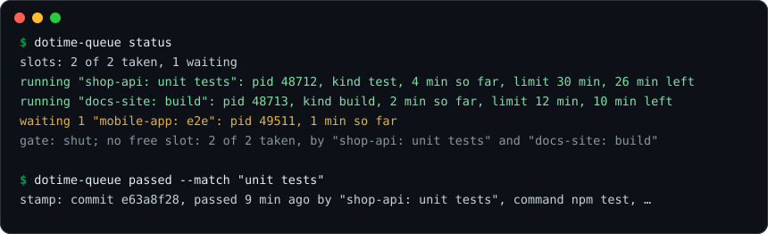

<p align="center">
  <picture>
    <source media="(prefers-color-scheme: dark)" srcset="docs/assets/logo-dark.svg">
    
  </picture>
</p>

<p align="center"><strong>Ship AI-written code to production, safely, one change at a time.</strong></p>

<p align="center">
  <a href="https://github.com/Moezat220/deployontime/actions/workflows/test.yml"></a>
  <a href="LICENSE"></a>
  
  
  
</p>

<p align="center">
  <a href="#install">Install</a> ·
  <a href="#how-it-works">How it works</a> ·
  <a href="#faq">FAQ</a> ·
  <a href="queue/README.md">Manual</a> ·
  <a href="#roadmap">Roadmap</a>
</p>

<br>

**Ready to use today: the machine queue** (macOS). It lets several coding agents share one computer without
overloading it. The rest of DeployOnTime is on the [roadmap](#roadmap).

<p align="center">
  
  <br>
  <sub>Example output, shortened.</sub>
</p>

## The problem

Coding agents each start their own test runs and builds. Three agents on one computer can mean three full test suites
at once: memory and CPU run out, tests that pass on their own start timing out, and an agent then "fixes" code that
was never broken. Each agent sees only its own run, so neither you nor the agents can see the real cause.

## What you get

| | Without a queue | With `dotime-queue` |
| --- | --- | --- |
| **Several agents start test suites** | They all run at once | At most 2 run together (`slots`); the rest wait their turn |
| **The computer is already busy** | New jobs pile on | Jobs wait while CPU, memory or disk is short, or the battery is low |
| **A job hangs** | It can run until someone notices | It is stopped at its time limit, with everything it started (exit 124) |
| **A check keeps failing on the same code** | An agent may keep re-running it | A third try is blocked for up to 6 hours (exit 3) until the code changes or `--after-fix` is given |
| **This commit already has a green run** | It may run again | `dotime-queue passed` says so, and the agent can skip it |
| **Where did the time go?** | No record | `dotime-queue history` totals waits and results per project |
| **Dev servers left running** | They keep using memory | An optional reaper stops the idle ones |

## How it works

The queue is a command that agents put in front of their heavy commands:

```
dotime-queue run --label "shop-api: unit tests" -- npm test
```

1. **Turn.** The job takes the next free slot, or waits its turn.
2. **Health.** Has the computer room for it? Before it starts, the queue looks at CPU load, free memory, free disk
   and, on battery, the charge.
3. **Limit.** It runs under a time limit learned from earlier passed runs: first the command's own, then those of its
   kind of job in the project, once either has five; before that, 30 minutes. A new command that takes longer than
   what its kind has learned (which can be as short as 10 minutes) needs `--max-run <minutes>`.
4. **Record.** Its wait, run time and result go into a journal that later runs and `history` use.

Only commands started through the queue are queued. A command an agent runs directly, such as a plain `npm test`, is
not. The queue never edits your repository; it keeps its state in `~/.dotime`.

## Install

Requirements: macOS, Node 22 or newer, git 2.31 or newer. No npm packages are downloaded.

```
git clone https://github.com/Moezat220/deployontime.git
cd deployontime
npm link                 # puts the dotime-queue command on your path
dotime-queue status
```

Then tell your agents to use it. For example, add this to their instruction file (such as `AGENTS.md` or `CLAUDE.md`):

```
Start every test run, build and other heavy command through the queue:
dotime-queue run --label "<project>: <task>" -- <command>
Before running a check, ask whether it already passed: dotime-queue passed --match "<check>"
```

The text before the colon in a label is the project name; limits and history are kept per project.

To remove it: `npm uninstall -g deployontime`, delete `~/.dotime`, and take the reaper out of your scheduler if you
added it.

Every command, flag, exit code and setting is in the [queue manual](queue/README.md).

## FAQ

<details>
<summary><strong>Does it work with my coding agent?</strong></summary>

Yes, with any agent that can run a shell command. There is no plugin; the agent only needs the instruction above.
</details>

<details>
<summary><strong>Does it watch everything on my computer?</strong></summary>

No. Only commands started with `dotime-queue run` are queued, held back or limited. Two optional extras look wider,
and only if you schedule them: the reaper (idle dev servers) and the scheduled-job report (your own scheduled jobs).
</details>

<details>
<summary><strong>Does it change my code or my files?</strong></summary>

No. In your repository it only reads: read-only git commands, and files to tell whether a check's code changed. Its
own state (slots, journal, settings) lives in `~/.dotime`.
</details>

<details>
<summary><strong>What does the reaper stop?</strong></summary>

When you schedule it, it stops dev servers of your user account that sit idle anywhere on the computer, including ones
started outside the queue. A trial run with `--dry` lists the servers it would stop and stops none, and a keep pattern
protects the servers you want left alone. See [the reaper](queue/README.md#reaper).
</details>

<details>
<summary><strong>Can agents in containers or virtual machines share it?</strong></summary>

No. Agents share one queue only when they use the same state folder on the same computer. An agent in a container or a
virtual machine sees a different process list, so it must not share the folder: it gets a queue of its own.
</details>

<details>
<summary><strong>Does it run on Linux or Windows?</strong></summary>

Not yet. It reads macOS tools such as `pmset` and `memory_pressure`. Linux is on the [roadmap](#roadmap).
</details>

<details>
<summary><strong>What does the AGPL license mean for me?</strong></summary>

Using the queue on your own computer does not put your projects under this license. Its conditions apply when you pass
this code on, changed or not, and when you let others use a changed version of it over a network.
</details>

## Roadmap

The machine queue is complete and usable on its own. These pieces come next, in this order:

| Next | What it will do |
| --- | --- |
| Release engine | Carry an agent's pull request through checks to a safe live release |
| Install and quickstart | Set everything up with one command, with a trial mode that changes nothing |
| Linux and Docker | Run the queue outside macOS |

## Tests

From the repository's top folder:

```
npm test
```

## License

Copyright (C) 2026 Moezat220 · [AGPL-3.0-only](LICENSE)
